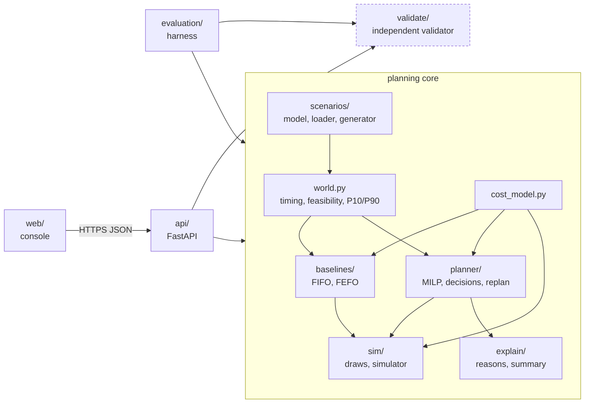
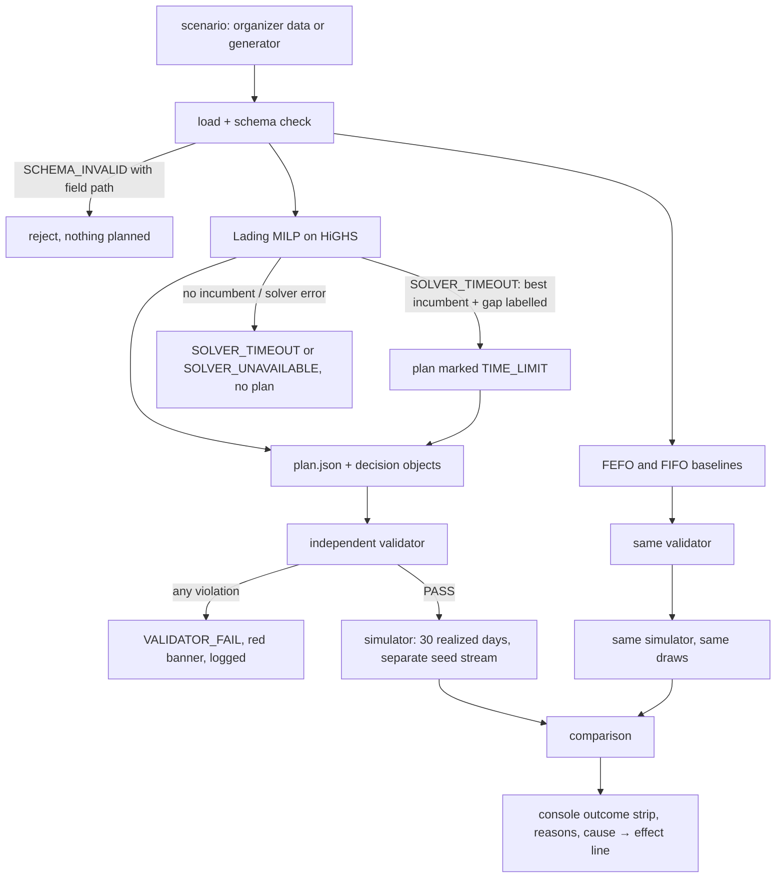
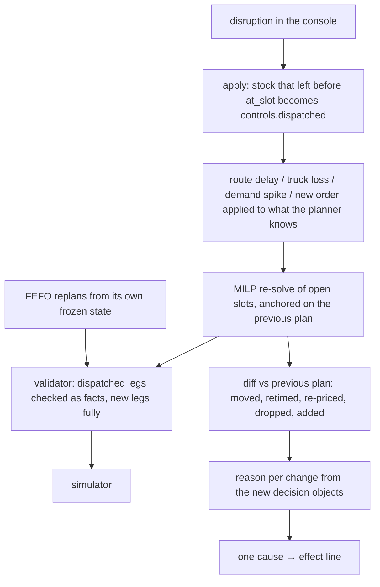

# Architecture

Lading is a Python planning core behind a FastAPI service, with a static React console on Vercel. The core is five modules with one-way dependencies, and the validator sits outside all of them.

`validate/` imports nothing from the repo, not even the scenario models or the cost model. It re-reads the scenario and plan as plain JSON and recomputes every constraint and total itself. `validate/test_independence.py` walks the AST and fails the build if that changes.

## Happy path

There is no fallback edge from the MILP to a baseline. If the solver can't produce a plan, the API returns the named state and the console says so.

## Replan path

## Failure states

| State | Trigger | What the product does |
|---|---|---|
| SCHEMA_INVALID | Missing field, negative kg, unknown market, bad request body | 422 with the exact field path, e.g. `batches[3].kg`. Nothing is planned. |
| INFEASIBLE_DEMAND | A batch no market can receive fresh at any open slot | Plans the rest. The batch sits in the "Can't be sold fresh" tray with "discount locally or salvage", and counts as spoilage in every arm equally. |
| SOLVER_TIMEOUT | 10 s live budget hit | Returns the best incumbent with its optimality gap and status TIME_LIMIT. With no incumbent, 504 and no plan. Never swaps in FEFO. |
| SOLVER_UNAVAILABLE | HiGHS error, or the two solve slots are busy for 20 s | 503 "solver unavailable". |
| VALIDATOR_FAIL | Any recomputed constraint broken on a Lading plan | 500 with the violation, logged as a bug. The plan is not shown as valid. |
| NO_TRUCK | A truck is lost | Re-solve with the remaining capacity; the diff shows which batches lost their slot. |
| LOCK_INFEASIBLE | A dispatcher lock that can't arrive fresh, or locks that overfill a slot | 409 with the lock that can't hold. |
| RATE_LIMITED / SCENARIO_TOO_LARGE | Over 20 solves a minute per IP, or more than 80 batches | 429 / 413. |

## The MILP

Decision variables are batch → market (binary), one price level per (market, commodity) from the 0/10/20/30% ladder (binary), and kg sold per price level (continuous). The arrive-and-handled-before-expiry-minus-margin rule is enforced by never creating a batch-market pair that breaks it from every open slot. Slots enter through each pair's last fresh slot and one cumulative truck-capacity row per slot; with trucks hired per slot that is exactly the condition for an earliest-deadline-first schedule, which `_schedule` builds after the solve. The objective is forecast net INR: revenue at the chosen price, minus freight and handling on every shipped kg, minus purchase value of unsold kg and of batches left to expire at the hub. Lading-point plans on forecast values; Lading-robust on P10 shelf life and P90 travel time. See [DECISIONS.md](DECISIONS.md) D1-D3 for why it has this shape.

## Determinism

HiGHS runs single-threaded with a fixed seed and stops on a 0.5% relative gap, never on the clock, during evaluation. Execution draws come from `SeedSequence([scenario seed, 202, draw, kind])`, indexed by scenario entities rather than plan contents, so every arm meets the same realized day. `make reproduce` twice on the same machine gives byte-identical results apart from `timings.json`; P6 in `results/controls.json` checks it inside one run and `deploy/clean-room.sh` checks it from a fresh clone.

## Deployment

The API runs as one container on a VPS, behind Caddy for TLS. On the current host another project's Caddy already owns ports 80/443, so the API joins that proxy's Docker network and `deploy/deploy-api.sh` adds one validated site block for the API hostname (see [SETUP.md](SETUP.md)). The console is a static Vite build pushed to Vercel with the CLI; it reaches the API only through `VITE_API_URL`. `results/` is baked into the image from the committed files and served read-only.
